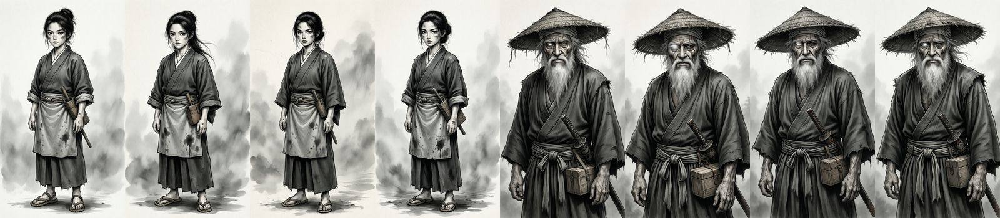
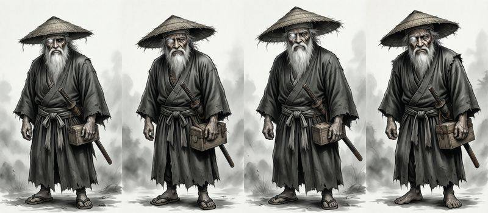

# Character evaluation (milestone 2)

Can the local models design a cast and draw consistent reference pictures?
Tested 2026-10-30 with the "Lantern Road" test manga (a mountain village in
1780, greyscale ink-wash style) on Qwen 3.8 27B (text) and Qwen-Image 2512
Lightning (images).

## Profiles

From one-line briefs ("the lantern-maker's daughter, sixteen, stubborn and
clever with her hands"; "an old one-eyed ronin who sells charms at the
shrine"), the text model wrote full profiles in about 7 s each: a fitting
name (Kaede), personality with a real flaw, want versus need, backstory tied
to the logline, speech habits, and a drawable look. Given the rest of the
cast, it deliberately contrasted silhouettes (wiry girl with a tight bun
against a hunched, bearded man in a wide straw hat) and said so in its notes.

## Design options

Four options per character, about 5 s each at 768×1344. Within a set the
character is strikingly consistent: same face, hair, outfit and props across
seeds, so the choice is mostly about pose and expression.

## Findings that shaped the code

- **Hue words override the colour mode.** The first profiles said "indigo
  kimono" and "brown leather apron", and a greyscale style came out in
  colour. The AI is now told to describe tones, not hues, unless the manga is
  in full colour, and character prompts end with a tone reminder ("Drawn
  entirely in shades of grey.").
- **A detailed face makes a medium shot.** Jubei's long face description
  cropped every option at the thighs, even at 3:4 and "head to feet". Calling
  it a "wide shot" with "empty space above the head and below the feet",
  stating the framing before and after the description, and a taller 9:16
  frame fixed it.

- **Styles with painted backgrounds keep them.** An ink-wash style adds mist
  behind the figure despite "plain white background". The figure stays clean
  and readable, so this is left as is for now; it may matter for the
  consistency sheets (next).
- **Negation again.** As with styles, "no" clauses are stripped from the AI's
  appearance and outfit text before they reach the image model.

## Next

- Turnaround (front, three-quarter, side) and expression sheets from the
  chosen reference with Qwen-Image-Edit, to check identity holds across
  angles.
