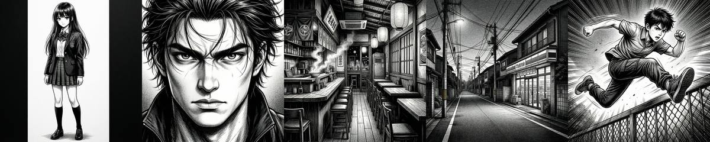
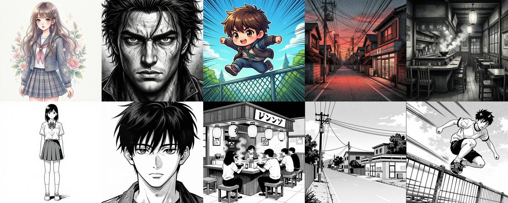
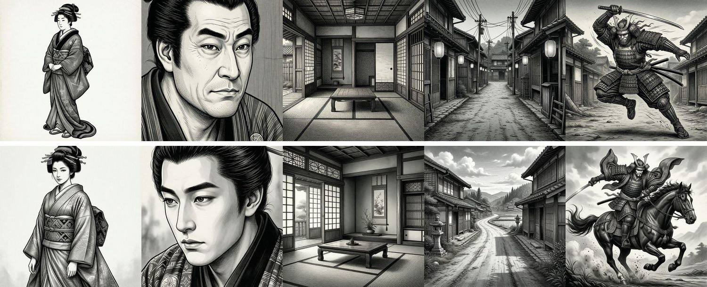
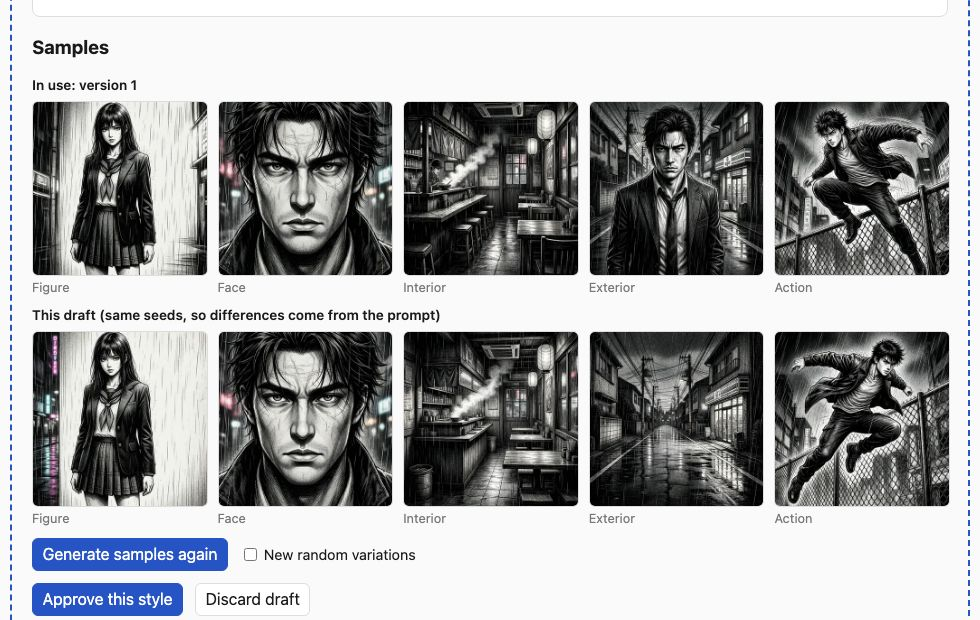

# Style evaluation (milestone 1)

Can the local image models draw manga, and in the range of styles a user might
ask for? Tested 2026-10-30 on an M5 Ultra through ComfyUI, 1024×1024, seed 42.

## Black and white manga — Qwen-Image 2512 (Lightning, 4 steps)

Prompt prefix: _"Black and white manga illustration, clean ink line art,
screentone shading, high contrast, no color."_ followed by each sample subject.

Clean inking, real screentone texture and speed lines. About **5 s per image**
once the model is loaded (13 s for the first).

## Range — Qwen-Image (top) and Z-Image Turbo (bottom)

Top row, Qwen-Image with five different style descriptions: shōjo watercolour,
gritty cross-hatched seinen, colour chibi, a black-and-red limited palette, and
painted greyscale. Bottom row, Z-Image Turbo with the black-and-white prompt.

- **Qwen-Image** follows the style description closely; every look came out
  distinct. It is the default.
- **Z-Image Turbo** (~7 s) gives a flatter, cleaner printed-page look, but
  ignored "No people" in the interior and drew pseudo-Japanese text on a sign.
  Offered as an option per style.
- **Neither model reads a negative prompt.** Both run few-step distilled
  samplers at CFG 1, where the negative prompt is never evaluated. The app
  sends none.

## Findings that shaped the code

- **Genre words leak subjects.** A "detective seinen" style put a man in a
  trench coat into the empty-street sample even with "No people." in the
  prompt. Fixes: the style fragment now ends with a full stop so the subject
  starts a new sentence, and location scenes start with "empty" and end
  "No people." (An early version also put `people` in the negative prompt,
  which had no effect; see above.)
- **Sample scenes must fit the style's world.** Fixed modern test scenes (a
  school uniform, a street with power lines) fought a historical style. The AI
  now writes the five scenes along with the style prompt, to match its era and
  setting, and the user can edit them.
- **Negation draws the thing negated.** Told to keep out power lines, the
  local text model wrote "no power lines" into the scene, and Qwen-Image drew
  them (top row below). The models write "no X" even when told not to, so the
  app strips negated clauses from the AI's text, and the AI is asked to
  describe what is there instead ("a dirt road under an open sky"). Bottom row:
  the same Edo-period style after the fix.

- **Same seeds across versions** make revisions comparable: the draft's samples
  sit under the approved version's, and differences come from the prompt.

- **Ollama structured output** (`format`) is unavailable for the MLX models
  (Ollama 0.34.3). Both Qwen 3.8 27B and Gemma 4 26B return clean JSON when
  asked in the prompt (2–3 s), so the text adapter extracts and validates the
  JSON (zod) and retries once with the error.

## Open

- Identity consistency across panels with Qwen-Image-Edit (milestone 2,
  characters).
- Whether a manga-specific LoRA improves screentone fidelity.
